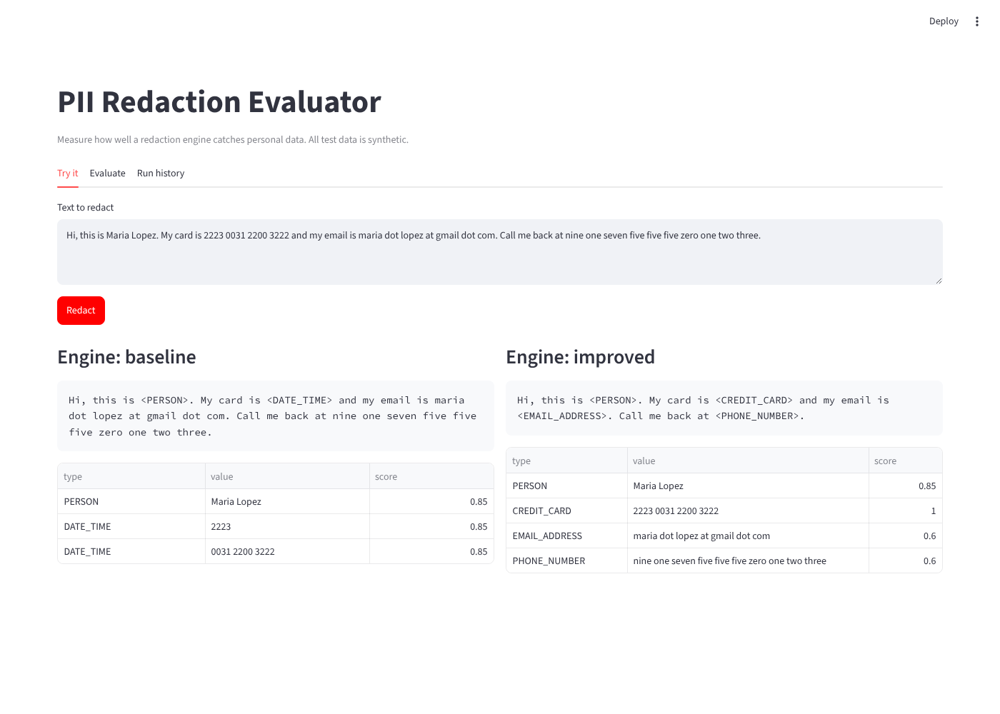
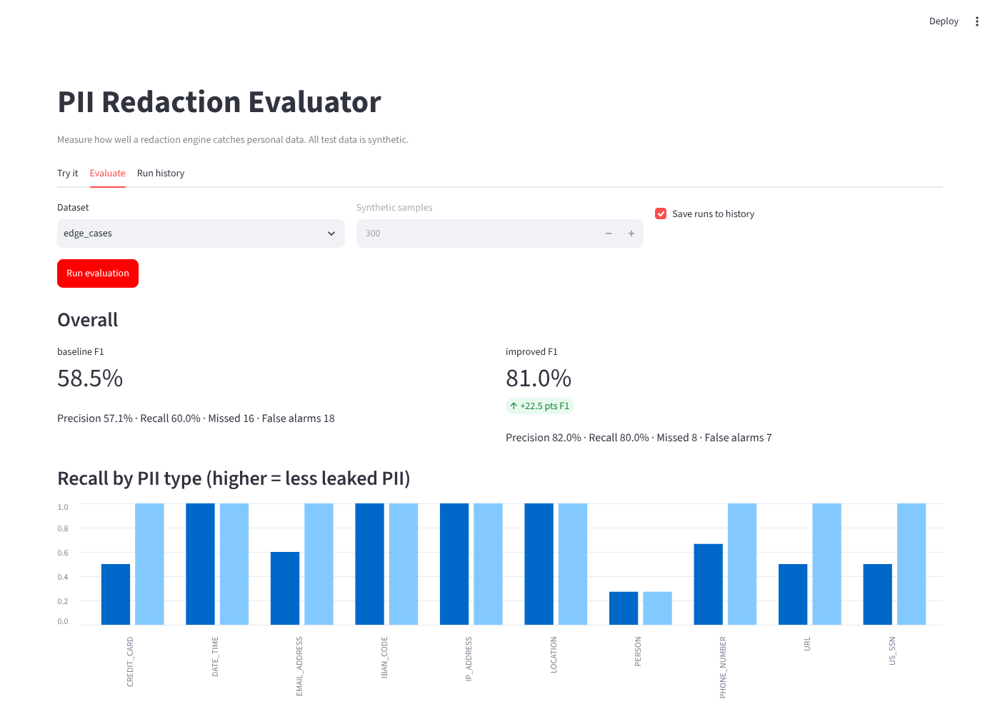
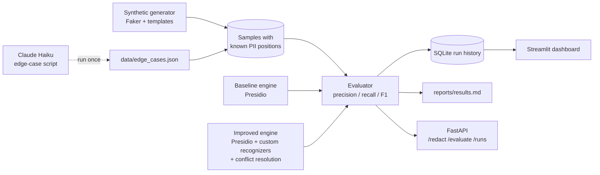

# PII Redaction Evaluator

[](https://github.com/sarthkjn/pii-redaction-eval/actions/workflows/ci.yml)


**Measure, then improve, how well a redaction engine removes personal data (PII) from customer-service text.**

Contact centers record and transcribe calls, and those transcripts are full of names, card numbers, SSNs and emails. Before transcripts are stored or used for analytics, a redaction engine is supposed to remove that data. The question this project answers is: **how much PII does the redactor actually miss, and on what kind of input?**

The project:

1. **Generates test data with known answers.** Synthetic transcripts where the location of every piece of PII is recorded, plus a set of hard "edge cases" (spoken numbers, spelled-out emails, unusual formats) that can be generated with Claude.
2. **Scores a redaction engine** with precision, recall and F1 for each of 10 PII types, and lists every miss.
3. **Improves the engine** with custom recognizers that target the failures the evaluation found, and proves the improvement with before/after numbers.
4. **Ships it like a product:** a REST API, a dashboard, run history in SQLite, 41 automated tests (including browser tests and quality gates), and CI on every push.

> All data in this repository is synthetic or fictional. No real personal data is used anywhere.

---

## Results

Engine: [Microsoft Presidio](https://github.com/microsoft/presidio) with spaCy `en_core_web_sm`. Full tables, including per-type scores and the list of misses, are in [`reports/results.md`](reports/results.md).

| Dataset | Engine | Precision | Recall | F1 | Missed PII | False alarms |
|---|---|---:|---:|---:|---:|---:|
| synthetic (300 samples) | baseline | 75.6% | 97.3% | 85.1% | 15 | 175 |
| synthetic (300 samples) | **improved** | **99.5%** | **98.9%** | **99.2%** | 6 | 3 |
| edge cases (30 samples) | baseline | 57.1% | 60.0% | 58.5% | 16 | 18 |
| edge cases (30 samples) | **improved** | **82.0%** | **80.0%** | **81.0%** | 8 | 7 |

### What the evaluation found

* **Clean text hides the problem.** The baseline catches 97% of PII in neatly formatted text but only 60% in realistic, messy input. Testing only on clean data would give a false sense of safety.
* **Newer Mastercard numbers leak.** Presidio's card pattern does not cover Mastercard's 2221–2720 range, so valid cards starting with "2" were missed entirely.
* **Voice transcripts break pattern matching.** "four one one one…" or "priya dot shah at gmail dot com" pass straight through, because the recognizers look for digits and `@`.
* **Most false alarms come from overlapping guesses.** The language model labels pieces of phone numbers and SSNs as dates, the domain inside every email as a URL, and phrases like "last year" as personal data.

### What the improved engine changes

Each change targets one finding above (see [`app/recognizers.py`](app/recognizers.py) and `resolve_conflicts` in [`app/redactor.py`](app/redactor.py)):

| Fix | Effect |
|---|---|
| Mastercard 2-series pattern with Luhn checksum | Card recall 81% → 100% on synthetic data, without matching random numbers |
| Spoken-number recognizer (digit words → digits, labelled by length: 16 card, 10 phone, 9 SSN), tolerant of "um"/"uh" | Catches cards, phones and SSNs read aloud |
| Spoken email and URL recognizers | Catches "name at domain dot com" |
| Conflict resolution: drop URLs inside emails, dates overlapping numeric IDs, relative dates, and the weaker of two numeric labels on the same text | False alarms on synthetic data 175 → 3 |

**Still missed:** lowercase names, names made of common words ("Grace Mills") and single-word names. These need a stronger NER model (see [Limitations](#limitations-and-honest-caveats)).

### Dashboard

| Try it: baseline vs improved | Evaluate: scores and recall by PII type |
|---|---|
|  |  |

---

## How it works



1. **Ground truth.** The generator fills templates like `"Callback number is {PHONE_NUMBER}. Ask for {PERSON}."` with fake values and records the exact character positions of each one.
2. **Detection.** Each engine returns the spans it thinks are PII.
3. **Scoring.** A prediction counts as correct if it has the right type and overlaps the planted value. Misses (false negatives) are the costly error because a miss is leaked data; false alarms only hurt readability. See [docs/EVALUATION.md](docs/EVALUATION.md) for the full method.

More detail: [code structure](docs/ARCHITECTURE.md) · [evaluation method](docs/EVALUATION.md) · [design decisions and trade-offs](docs/DECISIONS.md).

---

## Quick start

Works on macOS, Linux and Windows with Python 3.10–3.12 (3.11 recommended). No API key or paid service is needed for anything except the optional edge-case generator.

```bash
git clone https://github.com/sarthkjn/pii-redaction-eval.git
cd pii-redaction-eval

python -m venv .venv
source .venv/bin/activate          # Windows: .venv\Scripts\activate

pip install -r requirements-dev.txt
python -m spacy download en_core_web_sm
```

Check everything works:

```bash
pytest
```

You should see `39 passed, 2 deselected` (the 2 deselected are browser tests, covered below).

---

## Usage

### 1. Run the evaluation (command line)

```bash
python scripts/run_eval.py                                    # both engines on both datasets
python scripts/run_eval.py --dataset synthetic --engine baseline --n 500
```

Prints a summary and writes `reports/results.md` and `reports/results.json`. Each run is also saved to `data/runs.db` (add `--no-save` to skip).

### 2. Open the dashboard

```bash
streamlit run dashboard/streamlit_app.py
```

Opens http://localhost:8501 with three tabs:

* **Try it:** paste any text and see both engines' output side by side.
* **Evaluate:** run both engines on a dataset and compare scores per PII type.
* **Run history:** every saved evaluation run.

### 3. Use the REST API

```bash
uvicorn app.main:app --reload
```

Interactive docs: http://127.0.0.1:8000/docs

| Method | Endpoint | What it does |
|---|---|---|
| GET | `/health` | Liveness check |
| POST | `/redact` | Redact text. Body: `{"text": "...", "engine": "improved"}` |
| POST | `/evaluate` | Score an engine. Body: `{"dataset": "edge_cases", "engine": "baseline", "n_samples": 100, "save": true}` |
| GET | `/runs` | List saved runs |
| GET | `/runs/{id}` | Full report for one run |

Example:

```bash
curl -X POST http://127.0.0.1:8000/redact \
  -H "Content-Type: application/json" \
  -d '{"text": "Call me at nine one seven five five five zero one two three, I am Jane Doe"}'
```

```json
{
  "engine": "improved",
  "redacted_text": "Call me at <PHONE_NUMBER>, I am <PERSON>",
  "entities": [
    {"start": 11, "end": 59, "entity_type": "PHONE_NUMBER", "score": 0.6, "value": "nine one seven five five five zero one two three"},
    {"start": 66, "end": 74, "entity_type": "PERSON", "score": 0.85, "value": "Jane Doe"}
  ]
}
```

### 4. Generate new edge cases with Claude (optional)

The repo ships with a 30-case hand-written seed set in `data/edge_cases.json`. To generate a larger, fresh set with Claude:

```bash
cp .env.example .env          # then paste your ANTHROPIC_API_KEY into .env
python scripts/generate_edge_cases.py --dry-run      # preview the prompts, no API call
python scripts/generate_edge_cases.py                # ~48 cases across 8 categories
```

Design choices that keep this cheap and reliable:

* **Smallest model** (Claude Haiku) and a handful of requests. A full run should cost a few cents.
* **Generate once, commit the JSON.** Tests and CI read the saved file, so they are deterministic and never use the API key.
* **No character counting by the LLM.** Claude returns each PII value as text; the loader finds its position with a substring search, and any value not found verbatim is discarded.
* **Fictional data only**, enforced in the system prompt.

---

## Testing

| Layer | File | What it checks |
|---|---|---|
| Unit | `tests/test_evaluator.py` | Scoring math with fake engines: perfect, empty, partial overlap, wrong type, duplicates |
| Unit | `tests/test_recognizers.py` | Each custom recognizer and each conflict-resolution rule |
| Unit | `tests/test_generator.py`, `tests/test_datasets.py` | Spans point at the right text, seeds are reproducible, every edge-case label exists in its text |
| Integration | `tests/test_redactor.py` | Real Presidio engines, plus **quality gates**: CI fails if the improved engine drops below 95% recall / 90% precision on synthetic data, or stops beating the baseline on edge cases |
| API | `tests/test_api.py` | Every endpoint, input validation (422s), 404s, save-and-fetch round trip |
| End-to-end | `tests/e2e/test_dashboard.py` | Starts the dashboard and drives it in a real Chromium browser with Playwright |

```bash
pytest                                  # unit, integration and API tests (~5s)
playwright install chromium             # once
pytest -m e2e                           # browser tests (~15s)
ruff check .                            # lint
```

Every test uses a temporary database, so running tests never touches your run history.

**CI** ([`.github/workflows/ci.yml`](.github/workflows/ci.yml)) runs on every push and pull request: lint, all tests on Python 3.11 and 3.12, the evaluation report (uploaded as a build artifact), then the browser tests.

---

## Project structure

```
pii-redaction-eval/
├── app/
│   ├── config.py          # entity types, paths, model name: the one place to change settings
│   ├── models.py          # Span and Sample data types
│   ├── generator.py       # synthetic transcripts with known PII positions
│   ├── datasets.py        # loads "synthetic" and "edge_cases" datasets
│   ├── recognizers.py     # custom recognizers (2-series cards, spoken numbers/emails/URLs)
│   ├── redactor.py        # baseline and improved engines, conflict resolution
│   ├── evaluator.py       # matching and precision/recall/F1
│   ├── storage.py         # SQLite run history
│   └── main.py            # FastAPI app
├── dashboard/
│   └── streamlit_app.py   # dashboard
├── scripts/
│   ├── run_eval.py             # CLI: run evaluation, write report
│   └── generate_edge_cases.py  # the only file that calls the Claude API
├── data/
│   └── edge_cases.json    # hard test cases (committed)
├── reports/               # generated results (committed so readers can see them)
├── tests/                 # 41 tests: unit, integration, API, e2e
├── docs/                  # architecture, evaluation method, screenshots
└── .github/workflows/     # CI
```

---

## Limitations and honest caveats

* **The edge-case improvement is optimistic.** The custom recognizers were written after looking at failures in the seed set, so the 58% → 81% gain is measured partly on data that shaped the fix. The fair test is a **fresh, held-out** set: generate one with `scripts/generate_edge_cases.py` and re-run. The synthetic results do not have this problem, since the templates came first.
* **30 edge cases is small.** Per-type numbers on that set move a lot with one or two examples.
* **Names are the weakest type.** The small spaCy model misses lowercase names, common-word names and single names. A larger model (`en_core_web_lg`) or a transformer NER model should help; changing `SPACY_MODEL` in `app/config.py` is the only code change needed.
* **Overlap matching is lenient.** A detection that covers only part of a value counts as found, even though the uncovered part may still leak. A stricter "fraction of PII characters masked" metric would be a useful addition.
* **English and US formats** are the focus. The IBAN and UK phone cases are a start, not full international coverage.

## Roadmap

- [ ] Character-level leak metric alongside entity-level recall
- [ ] Compare spaCy `sm` vs `lg` vs a transformer model in the dashboard
- [ ] Held-out edge-case set generated with Claude, reported separately from the seed set
- [ ] Docker image and a hosted demo

## License

[MIT](LICENSE)
